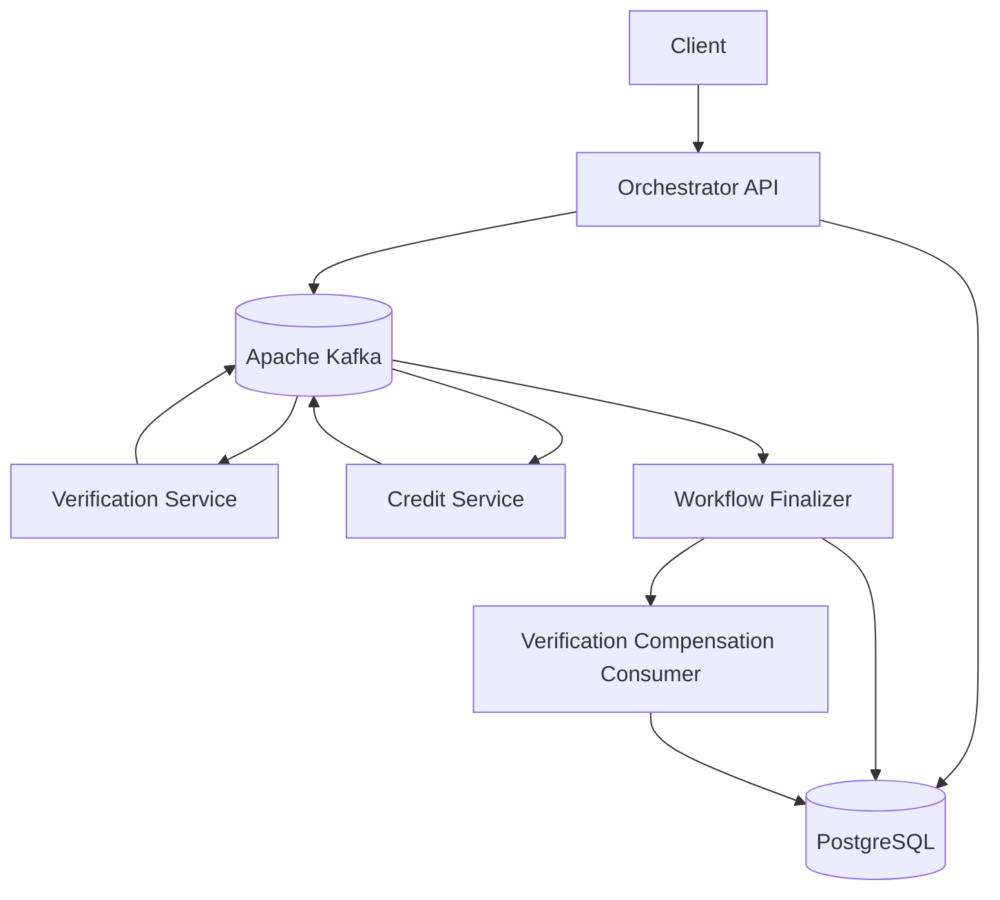

# FlowMaster — Distributed Task Orchestrator

A Node.js microservices project demonstrating a distributed workflow with Apache Kafka, PostgreSQL, and the Saga pattern.

## Architecture



## Technology Stack

- **Runtime:** Node.js
- **API:** Express.js
- **Messaging:** Apache Kafka with KafkaJS
- **Database:** PostgreSQL
- **Workflow configuration:** YAML
- **Infrastructure:** Docker Compose

## How the Workflow Works

1. A client submits a workflow through the REST API.
2. The API stores the workflow and its initial event in PostgreSQL, then publishes a Kafka event.
3. The Verification service processes the verification command and publishes a result.
4. If verification succeeds, the orchestrator advances the workflow to the credit step and publishes a credit-check command.
5. The Credit service approves or rejects the requested amount and publishes its result.
6. The finalizer updates the workflow status and appends an event to the event log.
7. If credit is rejected after successful verification, a compensation event is published. The verification compensation consumer records `VERIFICATION_COMPENSATED`.

## Requirements

- Node.js and npm
- Docker Desktop with Docker Compose
- PowerShell on Windows (commands below use PowerShell syntax)

## Configuration

Make sure the environment variables and PostgreSQL/Kafka connection settings in the project match your local setup. The workflow definition is in:

`config/loan-workflow.yaml`

## Installation and Startup

Run these commands from the project root.

### 1. Install dependencies

```powershell
npm install
```

### 2. Start Kafka and PostgreSQL

```powershell
docker compose up -d
docker compose ps
```

Wait until PostgreSQL reports healthy and Kafka is running.

### 3. Start the application services

Open a separate PowerShell terminal for each command below. Keep those terminals open.

```powershell
node .\src\server.js
```

```powershell
node .\src\orchestrator.js
```

```powershell
node .\src\verification.js
```

```powershell
node .\src\credit.js
```

```powershell
node .\src\finalizer.js
```

If your current setup uses the additional credit-compensation consumer, start it in another terminal:

```powershell
node .\src\compensation.js
```

## API Reference

### Health check

**Request**

```http
GET /health
```

Checks that the API and database are reachable.

### Create a workflow

**Request**

```http
POST /workflows
Content-Type: application/json
```

**Example request body**

```json
{
  "workflow_type": "loan",
  "input": {
    "applicantId": "TEST-SAGA-003",
    "amount": 150000
  }
}
```

The response includes the created workflow ID. Use that ID to query the workflow.

### Get workflow status and event history

**Request**

```http
GET /workflows/<workflow-id>
```

Returns the workflow record and its recorded events.

## Saga Failure Demonstration

To demonstrate compensation, submit a loan workflow with a valid `applicantId` and an amount greater than `100000`, for example:

```json
{
  "workflow_type": "loan",
  "input": {
    "applicantId": "TEST-SAGA-003",
    "amount": 150000
  }
}
```

The expected event sequence is:

1. `WORKFLOW_CREATED`
2. `VERIFICATION_PASSED`
3. `CREDIT_REJECTED`
4. `VERIFICATION_COMPENSATED`

The final workflow status should be `FAILED`. Query `GET /workflows/<workflow-id>` to inspect the status and event history.

For a successful credit outcome, use an amount at or below `100000` and provide an `applicantId`.

## Restart and Recovery

On orchestrator startup, the recovery routine queries PostgreSQL for workflows left in the `PENDING` verification step or `RUNNING` credit step and republishes the corresponding command.

This is a basic replay-based recovery approach. A command may be published more than once, so consumers should be idempotent to avoid duplicate side effects.

## Design Notes and Limitations

- PostgreSQL stores workflow state and workflow event history.
- Kafka is used for asynchronous communication between the workflow services.
- The compensation handler records/flags the successful verification as compensated. It does not reverse a side effect in an external verification provider.
- Recovery republishes commands for incomplete workflows and is not an exactly-once guarantee.
- A transactional outbox and distributed tracing/metrics are not documented as implemented in this version.

## Project Structure

```text
FlowMaster_harsh/
├── config/
│   └── loan-workflow.yaml
├── src/
│   ├── server.js
│   ├── orchestrator.js
│   ├── verification.js
│   ├── credit.js
│   ├── finalizer.js
│   ├── compensation.js
│   ├── db.js
│   └── kafka.js
├── docker-compose.yml
├── package.json
└── README.md
```
